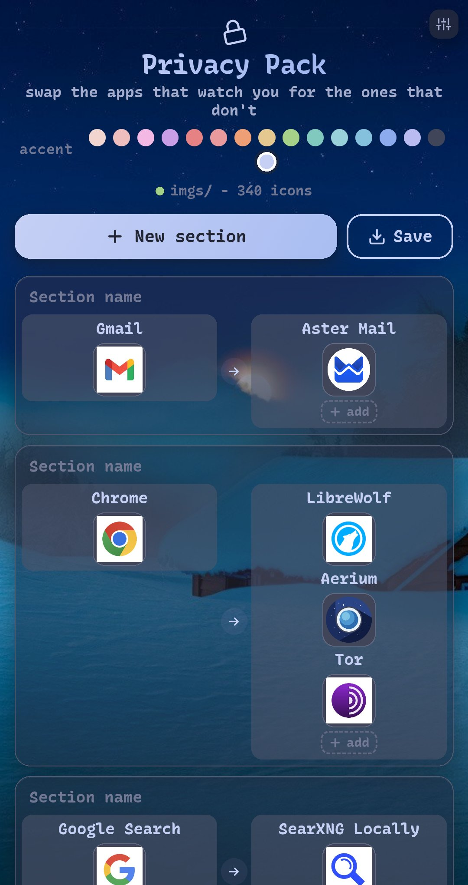
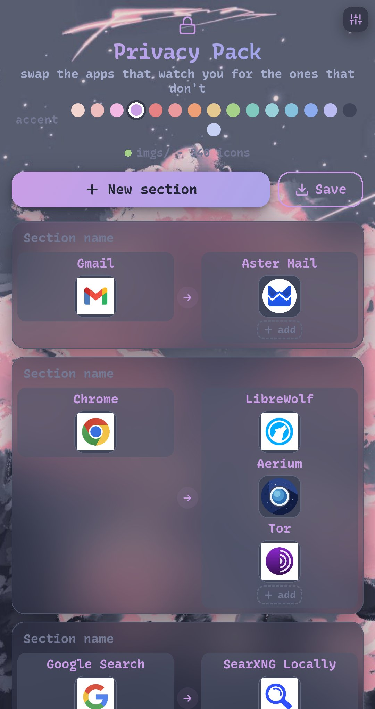

## Install

Note!
Supports:
`"png","jpg","jpeg","svg","webp","gif"...`

```in
git clone https://github.com/hyzi1/privacy-pack.git && cd privacy-pack && python -m http.server 8080
```

Browser:
```127
127.0.0.1:8080
```

## Demo

<p align="center">
  
  
  
  </p>

## Icons used

https://github.com/ente/privacypack
